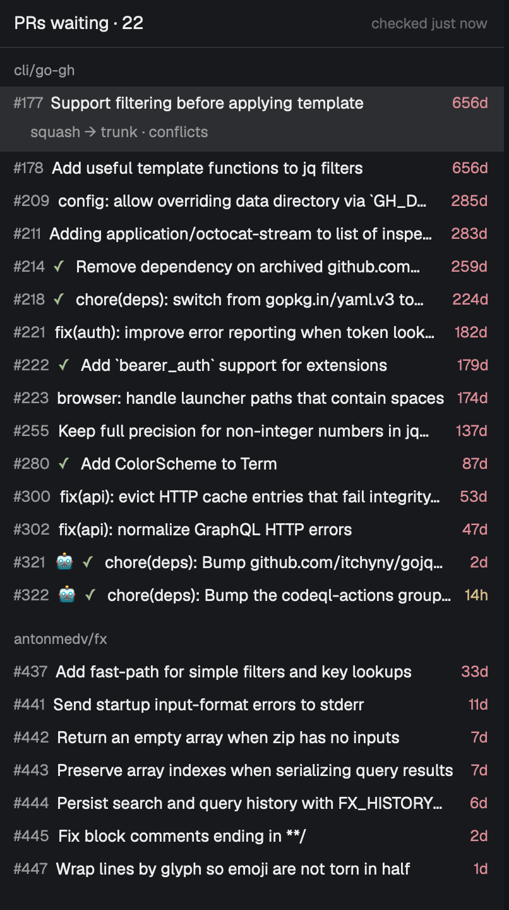

# pr-panel

A panel for the [Herdr](https://herdr.dev) desktop app that lists the open GitHub pull requests waiting on you and lets you merge them without leaving Herdr.



If you run many coding agents at once, PRs pile up across repos and you find them late. pr-panel keeps them in view, toasts once when a new one lands, shows a count in the top bar, and lets you peek at a PR and merge it in a keystroke or two. The merge method is picked for you, so a release PR is never squashed by accident.

## Requirements

- The [GitHub CLI](https://cli.github.com) (`gh`), installed and logged in (`gh auth login`). It needs a `gh` whose `gh auth status` accepts `--json` (check with `gh help auth status`); it was tested with gh 2.102.
- github.com accounts. GitHub Enterprise Server is not supported.
- Nothing else. No npm packages.

The programs it runs are `gh`, `sh` (to hand `gh` one account's token for one command) and `open` (to open links in your browser). `scripts/install.sh` also uses `rsync`. It talks to GitHub only through `gh`, with your `gh` credentials. It reads PR lists, descriptions and diffs, and it merges PRs when you ask it to. It also reads and writes two small files in `~/.config/herdr-app/` (its config and its state). It sends nothing anywhere else.

## Install

```
git clone https://github.com/donkitchen/herdr-pr-panel && cd herdr-pr-panel
scripts/install.sh
```

`install.sh` copies `mods/pr-panel/` to `~/.config/herdr-app/mods/pr-panel/` and runs `herdr-app check` on it. You can also copy `mods/pr-panel/` there by hand. Keep the folder name `pr-panel`: layouts and the mod itself refer to it by that name. The panel docks on the right of the window by itself. With no config file it shows your own PRs and the ones awaiting your review, for every account `gh` is logged into.

PRs that are already open the first time the panel runs do not toast, so installing it does not set off a burst.

## Configure

Optional. Everything personal lives in one file, `~/.config/herdr-app/pr-panel.json`. It sits outside the mod folder, so updating the mod never overwrites it. Changes apply without a restart. If the file is not valid JSON, the panel shows one line saying so and runs on defaults. If a setting has a wrong value, that setting keeps its default, the rest of the file still applies, and one line names the first problem. Unknown keys are ignored.

| Setting | Default | What it does |
|---|---|---|
| `scope.mine` | `true` | PRs you authored, or where your review is requested |
| `scope.owners` | `[]` | Also every open PR in repos owned by these users or orgs, any author |
| `scope.repos` | `[]` | Also every open PR in these `owner/repo`s |
| `scope.exclude` | `[]` | `owner/repo`s to leave out |
| `accounts` | every `gh` account | A list of `{ "login", "scope"? }` (github.com accounts). Each account uses its own `scope`; the top-level `scope` is the default |
| `refresh_seconds` | `60` | How often it checks GitHub (minimum 30; a smaller value uses 30 and says so) |
| `age.warn_hours` / `age.late_hours` | `4` / `24` | When a PR's age turns yellow / red |
| `bots` | `[]` | Extra logins to mark with a robot. GitHub's own bot accounts are always marked |
| `merge.default` | `"squash"` | The method for ordinary PRs (`squash`, `merge` or `rebase`) |
| `merge.keep_history` | non-default base, or head starting `release/` or `hotfix/` | When to use a merge commit instead. Keys: `non_default_base` (true/false), `head_prefixes` (list) |
| `merge.delete_branch` | `true` | Delete the PR's branch after merging. Never the repo's default branch, and never on a keep-history PR |
| `merge.repos` | `{}` | Per-repo overrides of the three merge settings above, keyed by `owner/repo` |
| `hand_off` | `[]` | PRs the panel must not merge. Each rule has `repo`, `base`, optional `head` prefix, `label` and `url` |
| `tickets.pattern` | off | A regex for ticket keys in titles and branches |
| `tickets.url` | off | Link template, e.g. `https://x.atlassian.net/browse/{key}` |

Repo names (`owner/repo` in `scope.exclude`, `merge.repos` and `hand_off`) match regardless of case, as on GitHub. Branch names are exact. Archived repos are always left out. Bots are decided by who the author is, never by PR text.

### An example

Shipped as [`examples/pr-panel.json`](examples/pr-panel.json); swap in your own names. It uses two `gh` accounts (a work one that also watches every PR in the `acme-co` org, minus one noisy repo, and a personal one), marks a bot account that GitHub does not flag, and hands one repo's release PRs off to a scheduling page.

```json
{
  "accounts": [
    { "login": "you", "scope": { "mine": true, "owners": ["acme-co"], "exclude": ["acme-co/legacy"] } },
    { "login": "you-personal", "scope": { "mine": true } }
  ],
  "bots": ["acme-bot"],
  "merge": { "default": "squash" },
  "hand_off": [
    {
      "repo": "acme-co/app",
      "base": "production",
      "label": "Scheduled release",
      "url": "https://example.com/releases"
    }
  ],
  "tickets": {
    "pattern": "\\b[A-Z][A-Z0-9]+-\\d+\\b",
    "url": "https://your-team.atlassian.net/browse/{key}"
  }
}
```

### Several GitHub accounts

If `gh` is logged into more than one account, the panel uses all of them. It never runs `gh auth switch`, so your active account stays as it was and agents in other terminals are not affected. Each call sets `GH_TOKEN` for that one command only, from `gh auth token --user <login>`. A PR found by more than one account appears once, and its peek and merge run as the account that found it. If one account fails, the others keep working and the message line names it and the fix.

If `GH_TOKEN` (or `GITHUB_TOKEN`) is already set in the environment Herdr was started from, `gh` uses that token for everything, so every account acts as that one token's user. Unset it to get per-account tokens.

## Stack it with other panels and add a top-bar button

On first install the panel docks on the right and that is all. Stacking it above another panel, or adding a "PRs" button with a count to the top bar, is a layout edit. A layout node shows the mod twice: once as the panel, and once with `"props": { "role": "toggle" }` as the button.

[`examples/layouts/pr-stack.json`](examples/layouts/pr-stack.json) is a full layout that does both: the panel gets a column of its own to the right of Herdr's Files and Changes panel, and the toggle sits at the right end of the tab row. You can stack other mods' panels in that column under it. Copy it to `~/.config/herdr-app/layouts/`, rename it if the name is taken, then switch to it. Your own layout stays as it was. Or ask your Herdr agent to add the two blocks to your own layout.

The two blocks, if you would rather add them by hand:

```json
{ "id": "pr-panel", "type": "block", "size": { "weight": 1 }, "content": { "mod": "pr-panel" } }
{ "id": "pr-panel-toggle", "type": "block", "size": { "px": 96 }, "content": { "mod": "pr-panel", "props": { "role": "toggle" } } }
```

The toggle shows and hides the panel. When everything in the panel's column is hidden, the empty column hides too, so no blank strip is left behind. This only happens in a column of its own: put the panel in a new column, not inside Herdr's `panel` column (the one holding Files and Changes, which Herdr's tabs show and hide themselves). A column holding a stack is never collapsed either.

## Keys

In the panel (click it to give it the keyboard):

| Key | Does |
|---|---|
| Up / Down | Move the selection |
| Enter, or click the selected row | Peek |
| `m` | Merge (asks first) |
| `o` | Open the PR on GitHub |
| `g` | Go to the agent pane on that branch, else the space for that repo |
| `r` | Refresh now |

In the peek (a large dialog over the window, not modal; it shows the description, the changed files and the colored diff):

| Key | Does |
|---|---|
| Up / Down, `k` / `j` | Scroll |
| Space / Shift+Space, Page Down / Page Up | Scroll a page down / up |
| Home / End | Top / bottom |
| `m` | Merge (opens the same confirmation; refused if new commits landed since the peek opened) |
| `o` | Open the PR on GitHub |
| Esc | Close |

In the merge confirmation:

| Key | Does |
|---|---|
| `y` | Merge now |
| `s` | Switch to the next method the repo allows |
| `w` | Merge when green (only while checks are running) |
| Esc | Cancel |

If checks have failed, the line turns red and `y` has to be pressed twice. A PR that is a draft, has conflicts, or is still being checked by GitHub cannot be merged, and the panel says why.

## How a merge is decided

When you press `m`, the method is chosen in this order:

1. If the PR matches a `hand_off` rule, nothing is merged. `m` and `o` open the rule's `url` instead.
2. If it matches `merge.keep_history` (by default: its base is not the repo's default branch, or its head starts with `release/` or `hotfix/`), it uses a merge commit.
3. Otherwise it uses `merge.default` (squash unless you set it).
4. A per-repo `default` in `merge.repos` wins over 2 and 3.
5. Only methods the repo allows are offered. If the chosen one is not allowed, the confirmation says so and `s` cycles through what is. The exception is a keep-history PR in a repo that does not allow merge commits: it does not fall back to squash. It asks you to pick a method with `s`.

The confirmation reads like `Squash #87 → main · deletes feat/x? (y · s switch method · Esc)` and shows the reason underneath. `· deletes {branch}` appears only when the merge will delete the head branch. Every merge pins the head commit the panel showed you (`--match-head-commit`), so code you have not seen cannot merge. After a merge the branch is deleted if `merge.delete_branch` is on (never the repo's default branch, and never on a keep-history PR, whose branch lives on), and the row goes away.

### Merge when green

If checks are still running, press `w` in the confirmation. The panel keeps its own queue (it never turns on GitHub's auto-merge): the PR shows as `queued`, and it merges on a refresh once the checks pass, at the head commit you confirmed. The request is cancelled, with a toast, if new commits arrive, the PR's base branch changes, it becomes a draft, it gets conflicts, the checks fail, it is closed or merged elsewhere, or it now matches a `hand_off` rule. The queue is saved, so it carries on after Herdr restarts, but it only advances while Herdr is open: if Herdr is closed when the checks pass, the merge happens the next time Herdr runs.

### Hand-off PRs

A `hand_off` PR sits in its own group at the bottom, labeled with the rule's `label`. It is not counted, its age never changes color, and it never toasts. This is for PRs that are released some other way, such as a scheduled release.

## What you see

- Header `PRs waiting · N` and when it last checked. Repos are grouped, oldest waiting PR first. When PRs come from more than one owner the groups show `owner/repo`.
- Each row: PR number, a robot for bot authors, check status (`✓` passed, `●` running, `✗` failed, nothing if the repo has no checks), the title, and the age in yellow or red past your `age` limits.
- The selected row also shows ticket links (if `tickets` is set) and the merge it would do, such as `squash → main`, with `conflicts` or `checking…` when that applies.
- Drafts are dimmed and tagged `draft`. They are not counted and do not toast. They count as new when marked ready.
- Failed checks and conflicts still count, because the PR is stuck and needs you.
- `Nothing waiting.` when the list is empty.
- If `gh` is missing, logged out, offline or rate limited, one line says what to do and the last list stays up, marked stale. If a search returns more than 100 PRs, it says `showing first 100`; PRs past the first 100 are not treated as closed, so they do not toast again later and queued merges for them wait.
- A toast `New PR · repo#N` the first time each PR is seen, once only, remembered across restarts. Posting a toast selects its PR, and clicking a toast shows the panel. With several toasts at once, the newest one's PR is the one selected. After a merge, a toast says `Merged owner/repo#N`.

## Sharp edges

- A per-repo `default` overrides keep-history. A per-repo `"default": "squash"` would squash that repo's release PRs too. Set it only where that is what you want.
- Merges always pin the head commit. If someone pushes between your confirm and the merge, it fails instead of merging unseen code.
- Merge when green only advances while Herdr is open.
- Release and non-default-base PRs use a merge commit. Squashing one into a long-lived branch makes it drift from the default branch.
- It only searches the scope you give it. `mine` means PRs you authored or were asked to review.
- Phase 2 is not included yet: telling an agent after a merge, and the Jira follow-up.

## Uninstall

Remove these:

- the mod folder, `~/.config/herdr-app/mods/pr-panel/`
- the config file, `~/.config/herdr-app/pr-panel.json`
- the state file, `~/.config/herdr-app/pr-panel.state.json` (it holds the PRs already toasted and the merge-when-green queue)
- the `pr-panel` and `pr-panel-toggle` blocks from any layout you added them to, or the layout file you copied from `examples/layouts/`

## Develop

The mod lives in `mods/pr-panel/`. `npm test` runs the unit tests for the pure modules (`node --test`, no dependencies). `scripts/install.sh` re-copies the mod, and Herdr reloads it live.

## License

MIT
