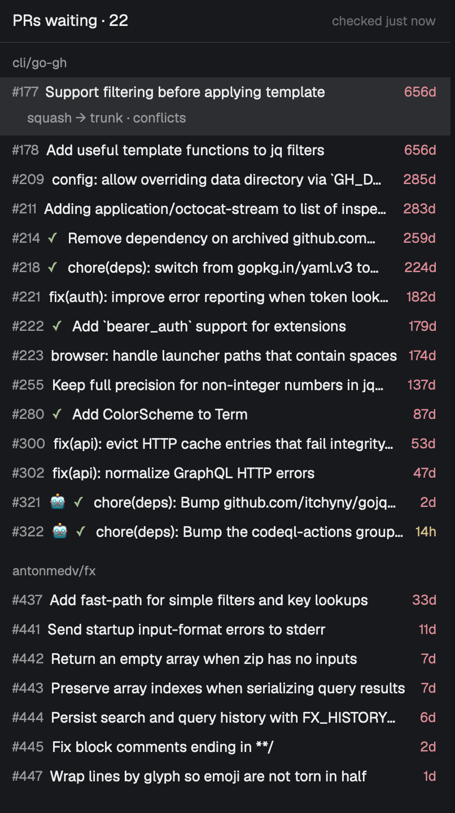

# pr-panel

A panel on the right side of the Herdr desktop app that lists the open GitHub pull requests waiting on you, grouped by repo, with check status and age. A "PRs" button with a count can sit in the top bar. You can peek at a PR (description and diff) and merge it with a couple of keys, and the merge method is chosen for you.

## What you see

The panel is a mod docked on the right, 340px wide, titled "PRs", focusable (click it to give it the keyboard). Top to bottom:

- Header: `PRs waiting · {n}` at ui font size + 1, semibold, with `checked {ago}` on the right (dim; yellow when the list is stale). Colors come only from `theme()`; no hex values.
- A message area, only when there is something to say: one line each in the theme's yellow (ansi3), for example a config problem (`pr-panel.json: ...`), a `gh` problem, or `showing first 100`. Lines are cut at 120 characters.
- The list, scrollable. Each repo is a small semibold muted group header, repos ordered by their oldest waiting PR. With PRs from more than one owner the header is `owner/repo`, otherwise `repo`. Each row is one line, 13px higher than the font size, 12px side padding:
  - `#{number}` muted;
  - a robot emoji if the author is a bot;
  - a check mark: `✓` green (passed), `●` pulsing opacity 0.35 to 1 over 1400ms (running), `✗` red (failed), nothing if the repo has no checks;
  - the title, truncated, dimmed for drafts;
  - a `draft` or `queued` tag where it applies;
  - the age on the right (`14h`, `2d`), yellow past `age.warn_hours` (4), red past `age.late_hours` (24). Drafts' and hand-offs' ages stay dim and never change color.
- The selected row has a highlighted background and a detail block under it: ticket keys (links when `tickets.url` is set) and the merge it would do, e.g. `squash → main`, with ` · conflicts` or ` · checking…` added when GitHub says so.
- Hand-off PRs sit in their own group at the bottom, headed by the rule's label.
- Empty state: centered, dim `Nothing waiting.` While the first fetch runs: `Checking GitHub…`.
- Footer hint line, 28px high: `⏎ peek · m merge · o GitHub · g go to agent · r refresh`.

The toggle (a second instance of the mod, `props: { role: "toggle" }`) is a small rounded button reading `PRs` and a count pill. The pill is the theme's accent color when anything is waiting, muted otherwise. The button is highlighted while the panel is shown.

The peek is a dialog (not modal) about 90% of the window: title, robot if a bot, `head → base`, check status, `+adds −dels`, ticket links, the description rendered as markdown, the list of changed files (click one to jump to it), and the full diff in colored rows in a read-only monospace view. The merge confirmation is a small modal dialog (560 by 150) with the PR on a muted line, the question in semibold, and a reason line.

Works with github.com accounts only (no GitHub Enterprise Server).

## How it behaves

Config is `~/.config/herdr-app/pr-panel.json`. Missing means defaults. Not valid JSON means one message line and defaults. A setting with a wrong value (a bad `merge.default`, a non-boolean `delete_branch`, a bad `keep_history` field or `age` value, a bad ticket regex, a list that isn't a list) keeps its default while the rest of the file applies, and the message line names the first problem. `"accounts": []` says `No accounts listed in pr-panel.json` and uses every account. Changes apply without a restart. Unknown keys are ignored. `refresh_seconds` is clamped to at least 30, and the message line says so. Repo names in `scope.exclude`, `merge.repos` and `hand_off` match regardless of case; branch names are exact.

Defaults: `scope.mine` true, `scope.owners`, `scope.repos`, `scope.exclude` empty, `refresh_seconds` 60, `age.warn_hours` 4, `age.late_hours` 24, `bots` empty, `merge.default` `squash`, `merge.keep_history` = base is not the repo's default branch, or head starts with `release/` or `hotfix/`, `merge.delete_branch` true, `merge.repos` empty, `hand_off` empty, `tickets.pattern` and `tickets.url` off. `accounts` unset means every account `gh` is logged into, each with the default scope.

Data:
- Every `refresh_seconds`, search each account for the PRs its scope covers: its own PRs and the ones awaiting its review (`scope.mine`), every open PR under `scope.owners` and in `scope.repos`, never archived repos. A PR found more than once appears once, remembering the account that found it first. Drop anything in `scope.exclude`. If a search reports more than 100 results, say `showing first 100`, and treat the list as incomplete: PRs missing from it are not forgotten (no repeat toasts) and queued merges for them wait.
- A bot is an author whose GraphQL type is `Bot`, or whose login is in `bots`. Never decided from PR text.
- Drafts are dimmed and are not counted or toasted. They count as new when marked ready. Failed checks and conflicts still count. Hand-off PRs are not counted, never red, never toast.
- `mergeable: UNKNOWN` is shown as `checking…`, offers no merge, and is rechecked on the next refresh. It is never treated as a conflict.
- Errors: `gh` missing (or `gh` failing to start at all) is `Install the GitHub CLI: https://cli.github.com`; logged out is `Run: gh auth login`, or for one account of several `Log {login} back in: gh auth login, then gh auth switch back`; offline is `Offline: showing last list`; rate limit (including the secondary rate limit) is `GitHub rate limit: showing last list`. The last good list stays up, marked stale. If one account fails the others keep working.
- The active `gh` account is never changed, so agents in other terminals are unaffected. A `GH_TOKEN` already set in Herdr's environment overrides the per-account tokens.

Toasts: the first time each PR is seen, a toast titled `New PR · {repo}#{n}` (prefix a robot for bots; `owner/repo` if more than one owner), body the PR title. Posting it selects that PR in the panel; clicking it shows the panel. With several toasts, the newest one's PR is the one selected, whichever toast is clicked. Exactly once per PR, remembered across restarts in `~/.config/herdr-app/pr-panel.state.json`. PRs already open the first time it runs do not toast. A PR that vanishes is removed silently.

Panel keys: Up and Down move; Enter (or clicking the selected row) peeks; `m` merges; `o` opens the PR in the browser; `g` focuses the agent pane whose branch is the PR's head, else selects the space whose folder name matches the repo; `r` refreshes now. Peek keys: Up/Down or `k`/`j` scroll, Space / Shift+Space and Page Down / Page Up page, Home and End jump, `m` merge (refused with `New commits since you peeked: peek again` if the PR's head moved since the peek opened), `o` opens the PR on GitHub, Esc closes. Links open only when they are http(s). Confirm keys: `y` merge now, `s` next allowed method, `w` merge when green (only while checks run), Esc cancels. Failed checks turn the line red and need `y` twice. Peek and merge run as the PR's own account.

Merge method, in order: a `hand_off` rule match (repo, base, optional head prefix) never merges and opens the rule's `url`; else keep-history gives a merge commit; else `merge.default`; a per-repo `default` in `merge.repos` wins over both of those. Only methods the repo allows are offered, and the confirm says when the first choice is not allowed. A keep-history PR in a repo that disallows merge commits does not fall back to squash: the confirm says `Pick a method: s` and `y` does nothing until one is picked. Confirm line: `{Method} #{n} → {base}? (y · s switch method · Esc)`, with ` · deletes {head}` before the `?` when the merge will delete the branch. A draft, a conflicting PR or an UNKNOWN one says why and does not open the confirm.

Every merge is pinned to the head commit the person saw, runs as the PR's account, and deletes the branch when `merge.delete_branch` is on (a per-repo value wins), except that the repo's default branch and a keep-history PR's head are never deleted. After success: toast `Merged {owner/repo}#{n}`, the row is removed at once, and it stays hidden for 10 minutes because search lags.

Merge when green is always the panel's own saved queue (shown with a `queued` tag), never GitHub auto-merge, so it only advances while Herdr is open. On each refresh where every search answered, each queued entry is decided in this order: PR gone drops it (but waits when the list was cut at 100); head commit moved drops it (`New commits on {repo}#{n}: merge cancelled`); base changed drops it (`Base changed on {repo}#{n}: merge cancelled`); draft drops it; conflicts drops it; failed checks drops it (`Checks failed on ...: merge cancelled`); checks running waits; UNKNOWN waits; otherwise merge. A hand-off PR never merges from the queue. The queue is written to the state file on every change and survives a restart.

Hiding: when the panel's parent column has every child hidden, the toggle view hides that parent too, and shows it again when any child is shown, so no blank strip remains. It only does this to a column of the panel's own: never Herdr's `panel` column, a column holding a stack, the root, or anything holding the tab area.

## Built from

- `mod.json`: `{"place":"right","size":340,"title":"PRs","focusable":true}`.
- `mods/pr-panel/main.js`: one `View` class that picks what to draw from `props.role`: `panel` (default), `toggle`, `peek` or `confirm`. Peek and confirm are opened with `openOverlay` as dialogs of the same mod (only the confirm is modal). The peek's `m` hands back the PR id and the head commit it showed. The confirm hands its answer to the panel through a shared value (`setShared`) with the PR id, method, `now` or `green`, head commit and a timestamp; the panel accepts it only if it is under 2 minutes old and matches the PR and head it opened the confirm for.
- Pure modules with no `herdr` imports, each with `node --test` tests: `config.js` (parse and defaults), `github.js` (search and GraphQL text, parsing, `ghCommand`, `ghError`), `model.js` (bot, classify, age, ticket keys, view model), `merge.js` (method choice, blockers, args, queue decisions, confirm logic), `seen.js` (notify-once), `diff.js` (diff rows), `collapse.js` (the empty-column rule). UI in `ui/panel.js`, `ui/peek.js`, `ui/confirm.js`, `ui/open.js` (opens http(s) links with `cx.open_url`).
- Searches: GraphQL `search` per account, `first:100`, queries `author:@me`, `review-requested:@me`, `user:{owner}`, `repo:{repo}`, each with `is:pr is:open archived:false`, polled with `cx.timer.every` (never `setTimeout`/`setInterval`).
- Accounts: `gh auth status --json hosts`. Never `gh auth switch`: every call runs `sh -c` that sets `GH_TOKEN` for that one command from `gh auth token --user {login} --hostname {host}`, so the token never appears in a command line.
- Merge: `gh pr merge {n} -R {repo} --squash|--merge|--rebase [--delete-branch] --match-head-commit {oid}`. Never `--auto`.
- `herdr` calls: `exec` (to run `gh`, `sh`, `open`), `readTextFile`, `writeTextFile`, `appHome`, `notify`, `openOverlay`, `setShared`/`shared`, `run` (`layout.toggle`, `layout.hide`, `layout.show`, `pane.focus`, `space.select`), `layout`, `panes`, `spaces`, `theme`, `settings`, `cx.timer.every`, `cx.open_url`.
- Programs run: `gh`, `sh -c` (to hand `gh` one account's token), and `open` (only as a fallback for http(s) links). `install.sh` uses `rsync`. It talks to GitHub through `gh`. Tested with gh 2.102; it needs a `gh` whose `gh auth status` has `--json`.
- Layout: the panel is a block `{"mod":"pr-panel"}`; the toggle is a block `{"mod":"pr-panel","props":{"role":"toggle"}}`, 96px wide, in the tab row. `examples/layouts/pr-stack.json` gives the panel its own 340px column to the right of Herdr's `panel` column (Files and Changes), with the toggle at the end of the tab row.
- Files in the repo: `mods/pr-panel/` (the mod), `scripts/install.sh` (rsync `mods/pr-panel/` to `~/.config/herdr-app/mods/pr-panel/` excluding `jsconfig.json` and `*.d.ts`, then `herdr-app check`), `examples/pr-panel.json`, `examples/layouts/pr-stack.json`, `LICENSE` (MIT).

## Watch out

- A mod cannot rearrange the window. It docks itself on the right on first install; stacking and the top-bar button are layout edits.
- Do not use `setTimeout` or `setInterval`; use `cx.timer.every` and native `.loop` animation. Never keep a `cx` for later.
- Herdr's runtime has no `structuredClone`; copy plain data with JSON.
- `tickets.pattern` is compiled with the `g` flag, so reset `lastIndex` or use `matchAll`.
- A per-repo `default` overrides keep-history, so a per-repo `squash` would squash release PRs. Document it.
- A merge must pin the head commit. A queued PR whose head moved, or whose base changed, must be dropped, not merged. Don't use `gh pr merge --auto`: GitHub would merge whatever is pushed later.
- The mod's name `pr-panel` is hardcoded (the overlays it opens, `panelNode`, and layouts' `content.mod`). Don't rename the folder.
- Give the panel a column of its own. Herdr's tabs mod hides and shows the `panel` column itself; if the PR panel lived in it, the empty-column rule would fight the tabs. The rule never touches `panel` or a column holding a stack.
- Search lags a merge, so a merged PR must be hidden for a while.
- A failed state save must not cause repeat toasts, and only one state write may run at a time.
- Keystrokes cannot be sent to a mod from outside, so key handling can only be proved by reading the code or a person pressing keys.
- Phase 2 is not built: telling a live agent after a merge, and the Jira follow-up.
- Assumes `gh` is installed and logged in (github.com only), and `rsync` for `install.sh`.

## Done when

- `herdr-app check ~/.config/herdr-app/mods/pr-panel` passes and `npm test` passes.
- With no config file, the panel lists your own PRs and the ones awaiting your review.
- With two `gh` accounts logged in, PRs from both appear and `gh auth status` shows the same active account afterward.
- A new PR toasts once, titled `New PR · {repo}#{n}`, and not again after a restart.
- Enter opens the peek with the description and the diff; Esc closes it.
- An ordinary PR squashes and its branch is deleted. A PR into a non-default base, or from `release/` or `hotfix/`, defaults to a merge commit. A `hand_off` PR opens its URL and cannot be merged.
- A PR with running checks can be queued with `w`, merges when they pass, and is dropped with a toast if new commits arrive, its base changes, or checks fail.
- With the toggle in the top bar, it shows the count and shows and hides the panel; hiding the only panel in a column leaves no blank strip.
- A grep for your own org, repo and account names over the published files prints nothing.
